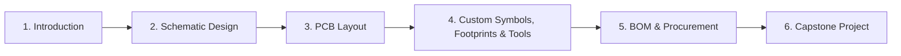

# 🔧 PCB Design Masterclass

> [!abstract] At a glance
> A **live, online, hands-on course** by **EnrgyLabs** that takes you from "what is a PCB?" to designing, ordering, soldering and testing your own boards in **KiCad**, with a path to paid PCB and embedded design projects with our team.
>
> - 📅 **Starts:** 1st November 2026
> - 🗓️ **Format:** Weekend live classes (November 2026 batch)
> - 👥 **Seats:** Limited to **40 participants**
> - 🌐 **Website:** [www.enrgylabs.com](https://www.enrgylabs.com)  (Under construction!! NOT TO USE!!!)
> - 📝 **Enroll:** Scan the QR code on our flyer or use the link in the description, or find the link in this document

---

## 1. Why this course?

Almost every electronic product, from a smartwatch to a factory sensor, starts as a printed circuit board. Yet most engineering courses teach theory and rarely let you **design, manufacture and solder a real board**.

This masterclass closes that gap. You learn with industry-style workflows, build real projects, and finish with boards you have designed yourself that actually work.

**What makes it different**

| | |
|---|---|
| 🎯 **Project-first** | Every concept is applied immediately on a real board |
| 🧑‍🏫 **Live instruction** | Ask questions in real time, with Q&A and discussion in every module |
| 🛠️ **Complete workflow** | Schematic → layout → manufacturing files → procurement → soldering → testing |
| 🤖 **Modern toolchain** | Using AI assistants and Git version control in PCB design |
| 💼 **Real opportunities** | Qualified participants can take on paid PCB and embedded design projects with EnrgyLabs |
| 🆓 **Free, open-source tools** | Everything is taught in KiCad, so you can keep designing at no software cost |

---

## 2. Who is this for?

- 🎓 **Engineering students** (electronics, electrical, mechatronics, computer engineering, physics) who want practical skills
- 🧑‍💻 **Young professionals** moving toward hardware or embedded roles
- 🧪 **Hobbyists and makers** who want to turn breadboard prototypes into proper boards
- 🚀 **Startup founders and product builders** who want to understand hardware design
- 💼 **Aspiring freelancers** interested in PCB design projects

> [!tip] No prior PCB experience needed
> Beginners are welcome. Basic electronics knowledge helps (see [Prerequisites](4. Prerequisites), and everything PCB-specific is taught from scratch.

---

## 3. What you will learn

- [x] Create **schematics** and **footprint layouts** in KiCad
- [x] Understand **symbols vs. footprints**, **SMT vs. through-hole** components
- [x] Select components and **read datasheets** with confidence
- [x] **Import** symbols and footprints from the web
- [x] Build **custom symbols and footprints** from a datasheet
- [x] Route a PCB using **tracks, vias, layers, ground and copper planes**
- [x] Apply **design rules and manufacturing constraints** and pass **DRC**
- [x] Generate **Gerber, drill and manufacturing outputs**
- [x] Understand **fabrication, assembly and BOM** processes
- [x] Go through a **live PCB procurement** process
- [x] Use **Git for KiCad** and collaborate with other engineers
- [x] Use **AI efficiently** to support your PCB design process
- [x] **Solder, test and verify** your finished design

---

## 4. Prerequisites

**Required**
- A laptop or desktop (Windows or macOS) that can run KiCad
- A stable internet connection for live sessions
- Curiosity and willingness to build

**Helpful (not mandatory)**
- Basic electronics: voltage, current, resistors, LEDs, simple circuits
- Familiarity with reading simple circuit diagrams

**Software**
- **KiCad**, free and open source. Installation on Windows and macOS is guided in the first session.

---

## 5. Course structure

The course has **six modules**, each blending teaching, hands-on work, and Q&A.

### Module 1: Introduction
- Meet the instructors and the company
- Overview of the course structure and outcomes
- Information about **our freelancing opportunities** and the **selection criteria**
- Prerequisites and how to get the most out of the course
- What is **ECAD software**? What is a **PCB**?
- Why **KiCad**? Installing it on Windows and macOS
- Tour of KiCad and the PCB design workflow
- Preview of the base project and the final capstone project
- *Homework, Q&A, discussion*

### Module 2: Schematic Design
- The full PCB design workflow explained
- Introduction to the course project
- Searching the internet for components and **reading datasheets**
- **SMT vs. through-hole** components
- Placing components, with a detailed explanation of **symbols and footprints**
- Wires, labels and nets
- Understanding the toolbar and key tools
- Documentation and framing your schematic
- Final checks and remarks on schematic design
- *Homework, Q&A, discussion*

### Module 3: PCB Layout
- Board layers, grids and rules
- Board outline, **component placement** and **mounting holes**
- **Routing fundamentals:** tracks, vias and layers
- Routing a complete, simple PCB
- Design rules, **clearances** and **manufacturing constraints**
- **Ground planes, copper planes** and thermal considerations
- Silkscreen, labels, **test points** and documentation
- **Two-layer boards:** placing components on the bottom layer
- *Homework, Q&A, discussion*

### Module 4: Custom Symbols, Footprints, Version Control & AI
- **Importing** symbols and footprints from the internet
- **Creating custom symbols and footprints** from datasheets (with a worked example)
- Making **high-quality symbols** with proper labels and markings
- **Git for KiCad:** version control and collaborating with engineers on the same team
- **Using AI in PCB design:**
  - How to use the latest AI tools to design a better PCB
  - Practical use of AI assistants in your workflow
  - A discussion on the limits of AI, and whether AI could do all PCB design
- *Homework, Q&A, discussion*

### Module 5: BOM & Procurement
- **Gerber files, drill files** and manufacturing outputs
- The **PCB manufacturing process:** fabrication, assembly and BOM
- A **live procurement walkthrough** of a real PCB order
- Final capstone project details
- *Homework, Q&A, discussion*

### Module 6: Final Capstone Project
Design, build and verify a complete board of your own, then solder, test and present it to qualify for your certificate. See [Projects](#6-projects).

---

## 6. Projects

You learn by building. Three projects increase in difficulty.

### 🟦 Base Project: 2D LED Matrix
Built together during the live classes to practice the whole workflow end to end.

### 🟨 Homework Project: Automatic Night Light
A low-cost board that turns an LED on when it gets dark.

**Requirements**
- Battery powered
- **LDR** (light sensor) interfacing
- Power regulation
- LED interfacing
- On/off button
- **Through-hole components only**
- Easily solderable pads
- Compact layout
- Must pass **DRC**
- Target component budget: **about ₹100** in total

### 🟥 Final Capstone: Low-Power Microcontroller Alarm Clock
A complete embedded product that combines everything you have learned.

**Requirements**
- **Microcontroller** with on-board programming support
- **RTC** (real-time clock) for timekeeping
- **Buzzer** for the alarm and an LED indicator
- Battery power with **USB 5V** input option
- Power regulators
- Headers and connectors
- **Through-hole components only**, with easily solderable pads
- Compact layout
- Must pass **DRC**
- Target component budget: **about ₹200** maximum

> [!success] Pass the capstone → earn your certificate
> Completing and presenting the capstone project is the requirement for the course certificate.

---

## 7. What you get

| Benefit | Details |
|---|---|
| 📦 **PCBs and components** | Boards and components for all course projects are **delivered to you** |
| 🏅 **Certificate** | Validates your hardware design skills |
| 🔥 **Soldering iron toolkit** | Provided for beginners |
| 🎥 **Live expert instruction** | Weekend classes with Q&A and discussion |
| 📘 **Practical portfolio** | Real, working boards you can show to employers and clients |
| 💬 **Community** | Learn alongside fellow students and engineers (see our Discord via the website) |
| 💼 **Opportunity pathway** | Eligible participants can apply for paid PCB/embedded design projects with EnrgyLabs |

---

## 8. Earn while you learn: the project opportunity

EnrgyLabs trains students and young professionals so they can take on **PCB design and embedded projects** for our company.

**How it works**
1. Complete the masterclass and capstone project
2. Receive your certificate
3. Be considered for paid project work based on our **selection criteria** (explained in Module 1)
4. Build industry experience while earning

> [!warning] Please note
> Project work is offered based on skill, performance and available projects. Participation in the course does **not** guarantee paid work or a specific income.

---

## 9. Career and skill outcomes

After this course you can:
- Confidently design **two-layer PCBs** from concept to manufacturing files
- Read datasheets and build **custom libraries**
- Prepare **production-ready outputs** and order boards
- Work in teams using **Git**
- Apply **AI tools** to speed up your design process
- Solder, debug and validate your own hardware

**Relevant roles and paths:** PCB design engineer, embedded/hardware engineer, electronics prototyping, hardware startups, freelance hardware design, maker/product development.

---

## 10. Tools and technologies

| Area | Tool |
|---|---|
| ECAD | **KiCad** (free, open source) |
| Version control | **Git** |
| Productivity | Modern **AI assistants** |
| Manufacturing | Gerber and drill files, fabrication and assembly workflow |
| Hands-on | Soldering, testing, and verification |

---

## 11. Logistics

- **Mode:** Live online classes
- **Schedule:** Weekends, starting **1st November 2026**
- **Class size:** Limited to **40 seats** for interaction and support
- **Session timings and duration:** 2 hours each on Sat and Sun (Date and Time will be announced later on Discord after Enrollement!) following IST timings
- **Fee:** 5500 Rs (including all project components and PCB's)
- **Shipping:** Project kits delivered to you; More details you get in the lecture
- **Language:** English Preferred in Lectures

---

## 12. How to enroll

1. Scan the **QR code** on our flyer, or use the enrollment link :  [https://shorturl.at/Y9cNL](https://shorturl.at/Y9cNL)
2. Complete the registration and payment
3. Receive confirmation and joining instructions through email. (Make sure you give valid email address in payment)
4. Install KiCad before the first class (guidance provided)

> [!important] Only 40 places
> Seats are limited, so enroll early. The payment gateway closes when limit is reached

---

## 13. Frequently asked questions

**Do I need prior PCB design experience?**
No. The course starts from fundamentals. Basic electronics knowledge is helpful.

**Do I need to buy software?**
No. KiCad is free and open source.

**Which operating systems are supported?**
Windows and macOS. Installation is guided in the first session.

**Do I need to own a soldering iron?**
No. A beginner soldering toolkit is included.

**Will I receive the PCBs and components?**
Yes. Boards and components for the course projects are delivered to you.

**Are classes recorded?**
The classes are not recorded. We will inform everyone if we plan to record the lectures

**What if I miss a class?**
Attendance is mandatory. Missing a lecturer means you have to study the topics discussed in the missed lecture on your own. You can ask your fellow students for help. We can provide support in Discord but you are expected to catch up on your own.

**How do I get the certificate?**
Complete the projects and pass the capstone requirements, including a board that passes DRC.

**Is this course only for students?**
No. Students, young professionals, makers and founders are all welcome.

**Will I definitely get paid projects?**
Not guaranteed. Opportunities depend on skill, performance and project availability.

**Is AI going to replace PCB designers?**
We discuss this openly in the course. You will learn how to use AI as a powerful assistant while building the judgment that AI cannot replace.

**Can I use what I learn professionally?**
Yes. The workflow is industry-style, and your skills transfer to any ECAD tool.

---

## 14. Stay connected

- 🌐 **Website:** [www.enrgylabs.com](https://www.enrgylabs.com)
-  📸 Instagram : https://shorturl.at/5yF6y
-  💼 LinkedIn : 
- 📘 Whatsapp Group: 
-  💬 Discord : 

---

*EnrgyLabs: build real hardware, learn real skills.*
